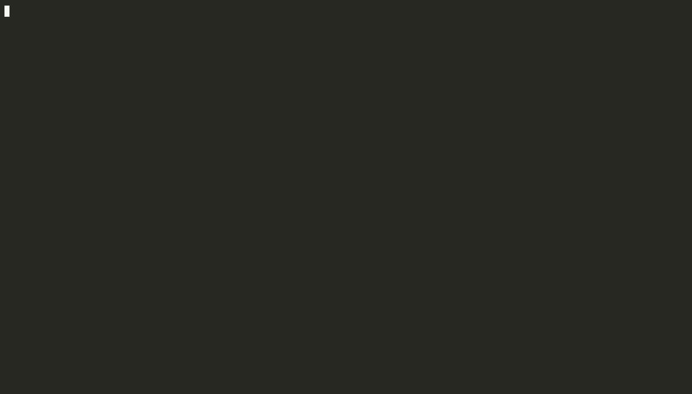

# MassIVE CLI

[](https://github.com/LucaCappelletti94/massive-cli/actions/workflows/ci.yml)
[](https://github.com/LucaCappelletti94/massive-cli/blob/main/LICENSE)

Build a deduplicated MassIVE mzML-derived MS/MS corpus, shard the result as zstd-compressed MGF, and resume the whole pipeline across crashes and reboots.



## Usage

```bash
cp .env.example .env
cargo build --release
./target/release/massive download
./target/release/massive convert
```

`download` opens a `ratatui` TUI that streams mzML files from `massive-ftp.ucsd.edu` with REST-resume, and updates live histograms of peak count, MS2-per-file, precursor m/z, charge, polarity, dissociation method, and instrument. `convert` parses the downloaded mzML files, deduplicates spectra by `(SPLASH, PEPMASS)`, and writes zstd-compressed MGF shards. Both stages persist state in SQLite via Diesel and are safe to interrupt.
